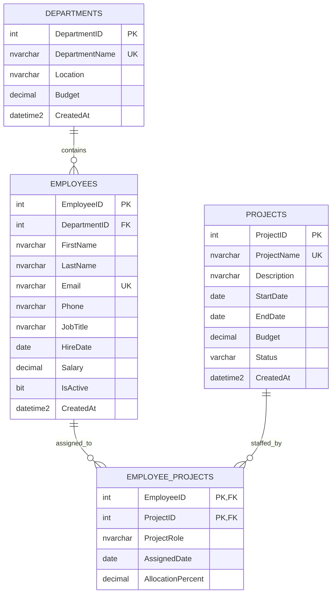

# DBINSIGHT — Employee Management Database

This repository contains an employee-management database design for SQLite and Microsoft SQL Server. It models departments, employees, projects, and employee assignments to projects. The SQL Server tables use the `hr` schema; SQLite does not use a named schema for these tables.

## Contents

- [`employee_management.sql`](./employee_management.sql) — creates the schema objects, inserts repeatable sample data, and runs a row-count verification query.
- [`employee_management.db`](./employee_management.db) — ready-to-open SQLite database containing the schema and sample data.
- [`employee_management_erd.md`](./employee_management_erd.md) — ER diagram and a concise design reference.
- [`insightSQL_architecture.md`](./insightSQL_architecture.md) — Streamlit, Python, SQLite, OpenAI GPT, and pytest application architecture, including diagrams and security, logging, exception-handling, and testing strategies.
- [`app.py`](./app.py) and [`insightsql/`](./insightsql) — the insightSQL Streamlit application and its validated, read-only SQL services.
- [`tests/`](./tests) — pytest security, database, and configuration tests.

## Run insightSQL

Use Python 3.10 or later. From the repository directory in PowerShell:

```powershell
py -m venv .venv
.\.venv\Scripts\Activate.ps1
py -m pip install -r requirements.txt
```

An OpenAI API key is optional. Without a key, the app uses offline templates for common questions (employee counts/lists, department lists and counts, project lists, and project assignment counts). For other questions, configure `OPENAI_API_KEY` in a local `.env` file using `.env.example` as a template. Never commit or share your key.

Launch the app:

```powershell
streamlit run app.py
```

The app opens in a browser. Enter a natural-language question, inspect the generated SQL, and explicitly choose **Run this query** to view results. Successful queries appear in session history, where they can be loaded for review and rerun. Query history is held in Streamlit session state and is not persisted to disk.

### Application safety

- Only one parsed `SELECT` query is accepted. DDL/DML, multiple statements, system or unapproved tables, attached databases, and dangerous extension functions are rejected.
- SQL executes using a SQLite read-only connection with query-only mode, a row cap, and a query time limit. The validated SQL is checked again immediately before execution.
- When configured, the OpenAI API receives the question and schema description, not database rows. Never put real employee information or other confidential data into prompts.
- The app is designed for local or trusted internal use. Add authentication and authorization before multi-user or public deployment.

The database file is [`employee_management.db`](./employee_management.db), in the repository folder. It contains `departments`, `employees`, `projects`, and `employee_projects` and sample data: **5 departments, 20 employees, 10 projects, and 30 assignments**.

### Run tests

```powershell
py -m pip install -r requirements-dev.txt
py -m pytest
```

Tests use temporary SQLite databases and do not call the live OpenAI API.

## SQL Server setup

To create the SQL Server version, open `employee_management.sql` in SQL Server Management Studio (SSMS) or Azure Data Studio, connect to the target SQL Server, select the target database, and execute the full script. The script creates the `hr` schema if absent, creates each table and index if absent, and inserts sample rows only when their unique identifying names or emails are not already present. The insert section uses a transaction and rolls it back if an error occurs. It does not create a database; choose or create the target database before running it. The script ends with a row-count query.

## Data model



### Relationships

- One department can contain many employees. Every employee belongs to exactly one department.
- Employees and projects have a many-to-many relationship, resolved by `hr.employee_projects`.
- An employee can have at most one assignment row per project. The assignment table's composite primary key enforces this.
- Foreign keys use SQL Server's default `NO ACTION` behavior: a referenced department, employee, or project cannot be deleted while dependent rows exist.

## Tables and columns

All tables are in the `hr` schema. `NOT NULL` is assumed for columns unless marked nullable.

### `hr.departments`

Stores company departments.

| Column | SQL Server type | Rules / meaning |
|---|---|---|
| `DepartmentID` | `int` | Identity primary key. |
| `DepartmentName` | `nvarchar(100)` | Required; unique department name. |
| `Location` | `nvarchar(100)` | Required office/location. |
| `Budget` | `decimal(14,2)` | Required; must be non-negative. |
| `CreatedAt` | `datetime2(0)` | Required; defaults to UTC time at insertion. |

### `hr.employees`

Stores employee identity, department, contact, position, hire, and salary information.

| Column | SQL Server type | Rules / meaning |
|---|---|---|
| `EmployeeID` | `int` | Identity primary key. |
| `DepartmentID` | `int` | Required foreign key to `hr.departments.DepartmentID`. |
| `FirstName` | `nvarchar(60)` | Required first name. |
| `LastName` | `nvarchar(60)` | Required last name. |
| `Email` | `nvarchar(254)` | Required; unique email address. |
| `Phone` | `nvarchar(25)` | Optional contact number. |
| `JobTitle` | `nvarchar(100)` | Required job title. |
| `HireDate` | `date` | Required hire date. |
| `Salary` | `decimal(12,2)` | Required; must be non-negative. |
| `IsActive` | `bit` | Required; defaults to `1` (active). |
| `CreatedAt` | `datetime2(0)` | Required; defaults to UTC time at insertion. |

### `hr.projects`

Stores projects and their schedules, budgets, and statuses.

| Column | SQL Server type | Rules / meaning |
|---|---|---|
| `ProjectID` | `int` | Identity primary key. |
| `ProjectName` | `nvarchar(150)` | Required; unique project name. |
| `Description` | `nvarchar(500)` | Optional project description. |
| `StartDate` | `date` | Required project start date. |
| `EndDate` | `date` | Optional; if set, cannot be earlier than `StartDate`. |
| `Budget` | `decimal(14,2)` | Required; must be non-negative. |
| `Status` | `varchar(20)` | Required; defaults to `Planned`. Allowed values: `Planned`, `Active`, `On Hold`, `Completed`, `Cancelled`. |
| `CreatedAt` | `datetime2(0)` | Required; defaults to UTC time at insertion. |

### `hr.employee_projects`

Associates employees with projects and records their role and allocation.

| Column | SQL Server type | Rules / meaning |
|---|---|---|
| `EmployeeID` | `int` | Part of the composite primary key; foreign key to `hr.employees.EmployeeID`. |
| `ProjectID` | `int` | Part of the composite primary key; foreign key to `hr.projects.ProjectID`. |
| `ProjectRole` | `nvarchar(100)` | Required role on the project. |
| `AssignedDate` | `date` | Required assignment date. |
| `AllocationPercent` | `decimal(5,2)` | Required; defaults to `100.00`, must be greater than 0 and no more than 100. |

## Keys, constraints, and indexes

| Table | Primary key | Foreign keys | Additional constraints |
|---|---|---|---|
| `hr.departments` | `DepartmentID` | — | Unique `DepartmentName`; non-negative `Budget`. |
| `hr.employees` | `EmployeeID` | `DepartmentID` → `hr.departments.DepartmentID` | Unique `Email`; non-negative `Salary`; default active status and UTC creation time. |
| `hr.projects` | `ProjectID` | — | Unique `ProjectName`; non-negative `Budget`; valid date range; allowed status values. |
| `hr.employee_projects` | (`EmployeeID`, `ProjectID`) | `EmployeeID` → `hr.employees.EmployeeID`; `ProjectID` → `hr.projects.ProjectID` | Allocation is greater than 0 and no more than 100. |

Indexes created by the script:

- `IX_employees_DepartmentID` on `hr.employees (DepartmentID)` for department-based employee lookups.
- `IX_employee_projects_ProjectID` on `hr.employee_projects (ProjectID, EmployeeID)` for project-based assignment lookups.

## Sample data

The script seeds **5 departments, 20 employees, 10 projects, and 30 employee-project assignments**. Values are illustrative sample data; names and `example.com` email addresses are not real employee records. Budgets and salaries are expressed as decimal amounts, without an enforced currency.

### Departments

| Department | Location | Sample budget |
|---|---|---:|
| Engineering | Bengaluru | 2,500,000.00 |
| Human Resources | Bengaluru | 800,000.00 |
| Finance | Bengaluru | 1,200,000.00 |
| Sales | Mumbai | 1,800,000.00 |
| Information Technology | Bengaluru | 1,500,000.00 |

### Employees

The sample has four employees in each department. All are active by default. Exact emails, phone numbers, hire dates, and salaries are in the employee seed data in `employee_management.sql`.

| Employee | Job title | Department |
|---|---|---|
| Aarav Sharma | Software Engineer | Engineering |
| Ananya Rao | Senior Engineer | Engineering |
| Vikram Patel | Data Engineer | Engineering |
| Meera Iyer | Engineering Manager | Engineering |
| Rohan Kapoor | HR Generalist | Human Resources |
| Priya Nair | Talent Acquisition Lead | Human Resources |
| Karan Malhotra | HR Coordinator | Human Resources |
| Sneha Das | HR Manager | Human Resources |
| Aditya Kulkarni | Financial Analyst | Finance |
| Kavya Menon | Senior Accountant | Finance |
| Arjun Reddy | Finance Manager | Finance |
| Ishita Joshi | Payroll Specialist | Finance |
| Rahul Bose | Sales Executive | Sales |
| Pooja Singh | Account Manager | Sales |
| Neil Fernandes | Sales Analyst | Sales |
| Tanya Gupta | Sales Manager | Sales |
| Dev Chatterjee | System Administrator | Information Technology |
| Riya Krishnan | Database Administrator | Information Technology |
| Sameer Khan | IT Support Specialist | Information Technology |
| Lavanya Pillai | IT Manager | Information Technology |

### Projects

| Project | Sample budget | Initial status |
|---|---:|---|
| Employee Portal | 1,800,000.00 | Active |
| HRIS Modernization | 2,200,000.00 | Active |
| Finance Automation | 1,400,000.00 | Active |
| Customer Data Platform | 3,200,000.00 | Active |
| Cloud Migration | 2,800,000.00 | Active |
| Sales Analytics | 950,000.00 | Planned |
| Security Improvement | 1,250,000.00 | Active |
| Learning Platform | 780,000.00 | Planned |
| Payroll Integration | 1,100,000.00 | Active |
| Infrastructure Refresh | 2,000,000.00 | Planned |

Project descriptions and start/end dates are defined in the project seed data in `employee_management.sql`. An unset end date represents an ongoing or not-yet-scheduled end date.

### Employee/project assignment distribution

Each project has three sample assignments. The assignment table stores the project role, assignment date, and allocation percentage for each employee/project pair.

| Project | Assigned employees |
|---|---|
| Employee Portal | Aarav Sharma (Backend Developer, 50%); Ananya Rao (Tech Lead, 35%); Priya Nair (HR Product Owner, 20%). |
| HRIS Modernization | Rohan Kapoor (Business Analyst, 50%); Meera Iyer (Engineering Lead, 25%); Sneha Das (HR Sponsor, 15%). |
| Finance Automation | Aditya Kulkarni (Finance Analyst, 40%); Kavya Menon (Process Lead, 30%); Arjun Reddy (Finance Sponsor, 15%). |
| Customer Data Platform | Vikram Patel (Data Engineer, 50%); Riya Krishnan (Database Administrator, 30%); Neil Fernandes (Data Analyst, 20%). |
| Cloud Migration | Dev Chatterjee (Infrastructure Engineer, 50%); Lavanya Pillai (IT Project Sponsor, 15%); Meera Iyer (Engineering Advisor, 10%). |
| Sales Analytics | Rahul Bose (Sales Representative, 30%); Pooja Singh (Sales Product Owner, 25%); Tanya Gupta (Sales Sponsor, 10%). |
| Security Improvement | Sameer Khan (Support Specialist, 35%); Riya Krishnan (Database Security Lead, 20%); Dev Chatterjee (System Administrator, 25%). |
| Learning Platform | Priya Nair (Learning Lead, 25%); Karan Malhotra (HR Coordinator, 35%); Aarav Sharma (Integration Developer, 20%). |
| Payroll Integration | Ishita Joshi (Payroll Specialist, 40%); Aditya Kulkarni (Finance Analyst, 20%); Vikram Patel (Data Integration Lead, 25%). |
| Infrastructure Refresh | Lavanya Pillai (IT Project Manager, 30%); Dev Chatterjee (System Administrator, 40%); Sameer Khan (IT Support Specialist, 25%). |

The SQL script is the canonical source for all inserted record values, including exact phone numbers, emails, salaries, dates, descriptions, and assignment dates.

## Verify the sample row counts

The SQL script ends with this verification query:

```sql
SELECT
    (SELECT COUNT(*) FROM hr.departments) AS DepartmentCount,
    (SELECT COUNT(*) FROM hr.employees) AS EmployeeCount,
    (SELECT COUNT(*) FROM hr.projects) AS ProjectCount,
    (SELECT COUNT(*) FROM hr.employee_projects) AS AssignmentCount;
```

For an empty target schema before seeding, the expected result is `5`, `20`, `10`, and `30`, respectively. If the target tables already contain other records, the totals may be higher.

## Design notes

- The three entity tables use integer identity primary keys. The assignment table uses a composite key rather than a separate identity.
- Department and project names and employee email addresses are unique so seed rows can be safely matched on repeat runs.
- Salary, budgets, and allocation are stored as fixed-precision decimal values rather than floating point.
- Deletion is restricted by foreign keys rather than cascading, preserving referenced employee and assignment records.
- `CreatedAt` defaults use UTC (`SYSUTCDATETIME()`); sample hire, project, and assignment dates are illustrative.
