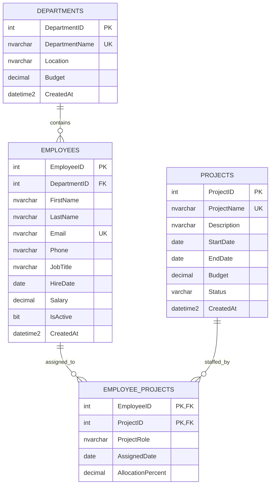

# Employee Management Database

## ER diagram

## Table distribution

| Table | Purpose | Relationship / expected sample rows |
|---|---|---|
| `hr.departments` | Department name, location, budget, and creation timestamp. | Parent of employees; 5 sample rows. |
| `hr.employees` | Employee identity, contact, job, hire, salary, and active status. | Each employee belongs to one department; 20 sample rows. |
| `hr.projects` | Project description, schedule, budget, and lifecycle status. | Parent of project assignments; 10 sample rows. |
| `hr.employee_projects` | Resolves the employee-to-project many-to-many relationship and stores the employee's project role, assignment date, and allocation. | One row per employee/project pair; 30 sample rows. |

The schema uses the `hr` SQL Server schema. Identity integer keys are used for the three entity tables. The junction table's composite key prevents an employee from being assigned to the same project more than once.

### Sample row distribution

| Department | Employees |
|---|---:|
| Engineering | 4 |
| Human Resources | 4 |
| Finance | 4 |
| Sales | 4 |
| Information Technology | 4 |

The 30 employee/project assignment rows are distributed evenly: each of the 10 sample projects has 3 assigned employees.

## Keys and referential integrity

| Table | Primary key | Foreign keys | Other uniqueness / checks |
|---|---|---|---|
| `hr.departments` | `DepartmentID` | None | `DepartmentName` unique; budget non-negative. |
| `hr.employees` | `EmployeeID` | `DepartmentID` → `hr.departments.DepartmentID` | `Email` unique; salary non-negative. |
| `hr.projects` | `ProjectID` | None | `ProjectName` unique; budget non-negative; end date cannot precede start date; status restricted to the supported values. |
| `hr.employee_projects` | (`EmployeeID`, `ProjectID`) | `EmployeeID` → `hr.employees.EmployeeID`; `ProjectID` → `hr.projects.ProjectID` | Allocation must be greater than 0 and at most 100. |

Foreign keys use SQL Server's default `NO ACTION` behavior: referenced departments, employees, and projects cannot be deleted while dependent rows exist. This avoids silently deleting employee or assignment records.

## Create and insert scripts

Run [`employee_management.sql`](./employee_management.sql) in SQL Server Management Studio or Azure Data Studio. It creates the tables and indexes, inserts the sample data in a transaction, and ends with a count query. The seed inserts are safe to rerun: existing sample entities are identified by their unique names or emails, and assignments by their composite key.

The sample seed provides at least 5 departments, 20 employees, and 10 projects, plus 30 employee/project assignments. Department and project budgets and employee salaries are illustrative sample values.
