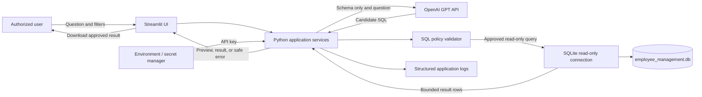
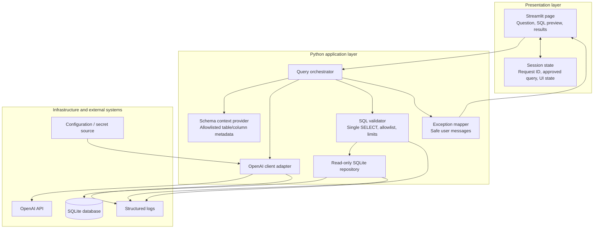

# insightSQL — Application Architecture

## 1. Purpose and scope

insightSQL is a Streamlit application that lets an authorized user ask questions about the employee-management database in natural language and inspect the resulting data. Python handles the application logic, SQLite stores the data, and OpenAI GPT translates questions into candidate SQL.

This document describes the architecture implemented by the Streamlit application. The repository includes the app entry point, Python services, tests, SQLite database, and SQL Server setup script; see [`app.py`](./app.py), [`insightsql/`](./insightsql), [`tests/`](./tests), [`employee_management.db`](./employee_management.db), [`employee_management.sql`](./employee_management.sql), and [`employee_management_erd.md`](./employee_management_erd.md).

### Technology choices

| Technology | Responsibility |
|---|---|
| Streamlit | User interface, session state, query preview, results, and errors. |
| Python | Application services, validation, database access, OpenAI integration, and observability. |
| SQLite | Local relational storage for departments, employees, projects, and employee-project assignments. |
| OpenAI GPT | Propose SQL from a user question and a limited description of the database schema. |
| pytest | Unit, integration, and security-regression testing. |

### Core design decision

Treat model output as untrusted input. GPT may propose a `SELECT` statement, but it does not connect to SQLite. The Python application validates the candidate and executes it through a read-only SQLite connection, with resource limits. Never expose an arbitrary SQL execution tool to the model.

For the first release, target a single-user or small trusted internal deployment. Streamlit session state is not a substitute for authentication or authorization. Add organization-approved authentication and per-user authorization before exposing the app to multiple users or the public internet.

## 2. Architecture diagram



The database is the source of truth. The model receives schema descriptions and the user's question, not database rows. The model does not see credentials or execute queries. The application validates every candidate query before opening the read-only execution connection.

## 3. Component diagram



### Component responsibilities

- **Streamlit page:** Collect a question, display the generated SQL for review, require explicit user approval before execution, and render bounded results. Do not put credentials in the UI or session state.
- **Query orchestrator:** Coordinate schema context, GPT generation, SQL validation, execution, and result shaping. Enforce a maximum result size and a per-request timeout.
- **Schema context provider:** Expose only approved table and column names, data types, and relationship summaries. Do not include sample records or sensitive values in the prompt.
- **OpenAI client adapter:** Own API configuration, timeouts, supported model selection, request IDs, response shape checks, and provider error translation.
- **SQL validator:** Parse and enforce the supported SQL subset; reject any statement that is not exactly one permitted read-only query.
- **Read-only SQLite repository:** Open the configured database safely, enable foreign-key checks as appropriate, apply a query timeout/progress limit, and return no more than the configured maximum number of rows.
- **Exception mapper:** Convert known internal failures into safe, actionable messages while preserving diagnostic details only in protected logs.
- **Configuration and secret source:** Load the OpenAI API key and application settings from environment variables or an approved secret manager, never committed files.

## 4. Data flow diagram

```mermaid
sequenceDiagram
    actor User
    participant UI as Streamlit UI
    participant Service as Query orchestrator
    participant Schema as Schema provider
    participant GPT as OpenAI GPT
    participant Guard as SQL validator
    participant DB as Read-only SQLite
    participant Log as Structured logger

    User->>UI: Enter natural-language question
    UI->>Service: Submit question and request ID
    Service->>Schema: Get approved schema metadata
    Schema-->>Service: Table/column definitions only
    Service->>GPT: Send question plus schema metadata
    GPT-->>Service: Candidate SQL
    Service->>Guard: Validate candidate SQL
    Guard->>Guard: Parse, allowlist, enforce SELECT-only and limits
    alt Invalid SQL
        Guard-->>Service: Rejection reason
        Service->>Log: Record rejection code and request ID
        Service-->>UI: Safe validation message; no query execution
    else Valid SQL
        Guard-->>Service: Normalized approved SQL
        Service-->>UI: Show SQL preview and request approval
        User->>UI: Approve execution
        UI->>Service: Execute approved query
        Service->>DB: Execute read-only with bound values and limits
        DB-->>Service: Bounded result set
        Service->>Log: Record timing, row count, and request ID
        Service-->>UI: Display results and optional export
    end
```

### Query lifecycle rules

1. Generate a candidate query; do not execute it automatically.
2. Show the candidate SQL to the user and require an explicit run action.
3. Validate again at execution time; do not trust session-state SQL as authorization.
4. Bind any user-supplied filter values as parameters. Never interpolate values into SQL strings.
5. Execute with read-only database access, a query progress/time limit, and a row limit.
6. Render or export only the returned bounded result set. Do not send query results back to GPT by default.

## 5. Folder structure

```text
insightSQL/
├── README.md
├── insightSQL_architecture.md
├── requirements.txt               # Runtime dependencies
├── requirements-dev.txt           # Test and lint dependencies
├── .env.example                   # Configuration template; no real secret
├── .gitignore                     # Secrets, caches, and local history
├── app.py                         # Streamlit entry point
├── insightsql/
│   ├── config.py                  # Validated environment-based settings
│   ├── database.py                # Read-only SQLite execution and limits
│   ├── errors.py                  # Typed application exceptions
│   ├── llm.py                     # OpenAI SQL-generation adapter
│   ├── schema.py                  # Schema and table/column allowlists
│   └── sql_policy.py              # SQL parsing and policy enforcement
├── employee_management.db         # Sample SQLite database
└── tests/
    ├── conftest.py                # Temporary SQLite test database fixtures
    ├── test_config.py
    ├── test_database.py
    └── test_sql_policy.py
```

The implemented structure keeps the Streamlit entry point at the repository root. Additional UI pages, finer-grained test directories, and a packaging configuration can be added when the application grows.

## 6. Security strategy

### Database and SQL execution

- Open the database using a URI in read-only mode (for example, SQLite URI `mode=ro`) for natural-language query execution. Use a separate, controlled migration/seed process for writes.
- Enforce `PRAGMA query_only = ON` on the execution connection. Do not rely on prompt instructions or a regular-expression-only check as the security boundary.
- Parse SQL with a maintained SQL parser and accept only one statement from a deliberately small allowlist: `SELECT` and, if required, read-only CTEs that ultimately select data.
- Reject DDL, DML, `ATTACH`/`DETACH`, `PRAGMA`, multiple statements, comments used to hide a second statement, extension loading, and unapproved functions or tables.
- Allowlist the four intended tables (`departments`, `employees`, `projects`, `employee_projects`) and permitted columns. Reject system tables and unapproved joins or subqueries according to the product's policy.
- Apply a maximum row count, execution deadline/progress handler, and reasonable output-size cap. Reject expensive or unbounded queries where feasible.
- Parameterize filter values. SQL identifiers cannot be parameterized, so validate table and column identifiers against the schema allowlist.
- Re-validate the exact SQL immediately before execution. Query preview/approval is a user-experience safeguard, not a substitute for validation.

### Sensitive information and OpenAI

- The employee database contains personal information (names, emails, phone numbers) and compensation. Restrict access to trusted users and avoid exposing it publicly.
- Send the model the user's question and only the minimum schema metadata needed to formulate SQL. Do not send employee rows, query results, secrets, or database files to OpenAI.
- Warn users not to enter personal, confidential, or regulated information into prompts. Review the organization's OpenAI data-handling and retention requirements before deployment.
- Keep the OpenAI API key in environment-based secrets or an approved secret manager. Never commit it, put it in Streamlit source, log it, or store it in browser-visible state.
- Use TLS for remote API traffic, set request timeouts, and apply provider rate limits and application-side quotas.

### Application and deployment

- Require authentication and role-based authorization before multi-user or internet-facing deployment. A shared Streamlit server must not treat a session identifier as proof of identity.
- Restrict filesystem permissions on the database, backups, logs, and secret files. Do not serve the database file as a static/downloadable application asset.
- Keep dependencies pinned and reviewed. Do not run shell commands, Python code, or arbitrary tools generated by the model.
- Use synthetic data for tests and demos; keep production database files and real records out of Git.
- Back up the database securely and test restoration. Define retention and deletion policies for database backups and logs.

## 7. Logging strategy

Use Python's standard `logging` package with structured JSON output in deployed environments. Include:

- UTC timestamp, severity, application version, environment, and request/correlation ID.
- Event name and stage (question received, model request, validation, execution, result, failure).
- Provider/model identifier where approved, latency, token/usage metadata where available, result row count, and validation outcome/rejection code.
- Exception type and stack trace in restricted diagnostic logs for unexpected failures.

Never log the OpenAI API key, authorization headers, full prompts, raw employee/project rows, salaries, email addresses, phone numbers, or unredacted query parameters. Prefer logging a normalized SQL fingerprint or query category over raw SQL; if raw SQL is essential for diagnostics, redact literals and restrict access and retention. Keep user-facing telemetry separate from security audit logs, protect log storage, and define retention appropriate to the data policy.

## 8. Exception handling strategy

Define explicit application exceptions, for example `ConfigurationError`, `ModelProviderError`, `SQLValidationError`, `DatabaseUnavailableError`, `QueryLimitExceededError`, and `QueryExecutionError`.

- **Configuration errors:** Fail fast at startup if required settings, such as the API key or database path, are missing or invalid. Never silently switch to a different database.
- **OpenAI errors:** Set connection and response timeouts. Handle rate limits and transient service errors with a small bounded retry policy and backoff; do not retry validation failures. Report service unavailability without exposing provider response details.
- **Invalid model output:** Treat malformed, empty, or policy-violating SQL as a rejected request. Do not execute it or attempt to “fix” it by executing a fallback query.
- **SQLite errors:** Catch expected connection, permission, and execution-time errors at the repository boundary; translate them to typed application exceptions. Preserve the original exception as the cause for protected logs.
- **Unexpected errors:** Log a correlation ID and traceback in restricted logs; return a generic message with the ID to the UI. Do not display stack traces, SQL internals, filesystem paths, or credentials.
- **Transactions and writes:** The natural-language query feature is read-only. If administrative writes are added later, isolate them in a separate service with explicit authorization and transactions.

## 9. Testing strategy

Use pytest and a temporary SQLite database created per test. Do not run tests against the developer's or production database. Mock OpenAI at the adapter boundary for deterministic unit and integration tests.

| Test level | What to verify |
|---|---|
| Unit | Configuration validation, prompt/schema context construction, response parsing, SQL policy decisions, result shaping, exception-to-message mapping, and redaction. |
| SQLite integration | Table/column access, foreign-key behavior, read-only connection enforcement, parameter binding, indexes/schema expectations, row limits, and query timeouts. |
| Service integration | Question → mocked GPT response → SQL validation → approved query → expected bounded result; invalid output must stop before database execution. |
| Security regression | Reject `INSERT`, `UPDATE`, `DELETE`, `DROP`, `CREATE`, `ALTER`, `PRAGMA`, `ATTACH`, multiple statements, comments/obfuscation bypasses, unauthorized tables/columns, and attempts to return excessive rows. |
| UI smoke tests | Streamlit page starts; question, preview, approval, results, empty results, and safe error states render. |
| Resilience | Missing key/database, malformed model response, provider timeout/rate limit, locked or corrupt test DB, and query deadline are handled with visible but non-sensitive errors. |

### Test gates

- Require formatting/linting, type checks if adopted, and `pytest` in continuous integration.
- Track coverage for the SQL policy, repository, and exception mapping; prioritize branch coverage for rejection paths over a single aggregate percentage.
- Include regression cases for every discovered SQL-validation bypass.
- Keep tests offline by default. Run optional live OpenAI smoke tests only in a controlled environment with an explicitly configured secret and non-sensitive prompts.
- Confirm each release with a database backup/restore test and a manual review of prompt data minimization and log redaction.

## 10. Operational defaults

Initial configurable defaults should be conservative: read-only database connection, explicit SQL approval, a finite result-row cap (for example, 500 rows), a short query deadline (for example, a few seconds), and bounded provider request timeout/retries. Make limits configurable through validated settings, but do not permit configuration to disable read-only enforcement or SQL validation in production.

For concurrent users or frequent writes, SQLite's single-writer model may become a bottleneck. Measure workload first; if it no longer fits, plan a deliberate migration to a server database rather than adding unsafe shared-file workarounds.
